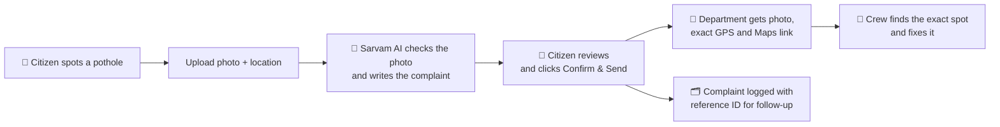

# 🕳️ Pothole Complaint Agent

**Snap a pothole → get a formal complaint, with the exact location, emailed to the road department in under 2 minutes.**

Built for the Sarvam AI Buildathon. Powered by Sarvam AI models (`gemma4`, `sarvam-105b`, `mayura:v1`).

🔗 **Live demo:** https://road-potholes-ewmefqxqdetwgk3tgtgrcw.streamlit.app

---

## The problem

Potholes cause accidents every year, especially for two-wheeler riders and pedestrians, and they get worse
every monsoon. Most stay unfixed. That's often not because nobody cares, but because **reporting one is hard**:

- **Vague complaints**, like "the road near the market is broken". The repair crew can't find the spot.
- **No evidence.** Without a photo the department can't judge how bad it is.
- **Effort and language.** Writing a formal letter to the right office, in the right language, takes time most people don't have.
- **No record.** People don't know if their complaint went anywhere, so they stop complaining.

## How this agent helps fix potholes

| Barrier | What the agent does |
|---|---|
| "Where exactly is it?" | Attaches **exact GPS coordinates** (from the photo or your phone) and a **Google Maps link**, so the crew can drive straight to the spot |
| "Is it really that bad?" | AI checks the photo, **confirms it's a pothole** and rates **severity** (low / medium / high), so departments can prioritise dangerous ones |
| "I don't know how to write it" | Writes a **formal, polite complaint letter** using only the facts you give it |
| "The office works in Hindi" | Adds a **Hindi or Hinglish** version (or 9 other Indian languages) under the English letter |
| "Did it even go?" | Sends the email **with the photo attached** and logs every complaint with a **reference ID** (`PH-YYYYMMDD-HHMM`) for follow-up |

**Who can use it:** citizens, resident welfare associations (RWAs), college students, NGOs, local journalists and
ward councillors. Anyone who wants a pothole on their road fixed.

### From pothole to repair



---

## How it works

1. **Upload a photo** of the pothole (JPG/PNG).
2. **Check photo:** `gemma4` confirms it's a pothole, rates severity and describes it ("Deep water-filled pothole in the left lane"). Non-pothole photos are rejected.
3. **Location**, from three sources:
   - 📍 **Your current location** (browser GPS, with accuracy)
   - 📷 **Photo GPS** (read from the photo's EXIF data)
   - ✍️ **Address, landmark, city and PIN** typed by you

   If the photo and your phone are more than 100 m apart, the app asks which one is the pothole. A map pin lets you confirm visually.
4. **Write complaint:** `sarvam-105b` writes the formal letter. `mayura:v1` adds the Hindi or Hinglish version.
5. **Review:** edit the subject and letter, and see the full email preview.
6. **Confirm & Send:** the email goes out through Gmail with the photo attached and is logged in `data/complaints.csv`.

> 🔒 **The location block is added by code, not by the AI**, so coordinates and links can never be changed or made up.

### Sample email

```
Subject: Pothole complaint – Near Lanka Gate, BHU, Varanasi (Severity: High)

Dear Sir/Madam,
I wish to bring to your attention a deep, water-filled pothole on Lanka Road near Lanka Gate, BHU ...
Yours sincerely, Ramesh Kumar

──────── Location details ────────
Address (reported): Lanka Road, Varanasi - 221005
Landmark: Near Lanka Gate, BHU
Pothole coordinates: 25.307111, 83.010278  (source: photo GPS)
Reporter's current location: 25.307120, 83.010260  (±15 m, 25 Oct 2026 10:42 IST)
Google Maps: https://www.google.com/maps?q=25.307111,83.010278

──────── Hindi version ────────
<Hindi letter>

Photo attached: pothole_20261025_1042.jpg
Reference: PH-20261025-1042
```

---

## Sarvam AI models

| Step | Model | Role |
|---|---|---|
| Photo check | `gemma4` (open model hosted on Sarvam) | Reads the image: is it a pothole, how severe, what's visible |
| Complaint letter | `sarvam-105b` (Sarvam's flagship LLM) | Formal, Indian-context complaint email from the given facts only |
| Translation | `mayura:v1` (Sarvam translation) | Hindi, Hinglish (Roman script), Bengali, Gujarati, Kannada, Malayalam, Marathi, Odia, Punjabi, Tamil, Telugu |

One API key (`SARVAM_API_KEY`) covers all three. Each complaint costs a few paise of Sarvam credits.

---

## Run locally

Needs Python 3.11+.

```bash
git clone https://github.com/ItshMoh/road-potholes.git
cd road-potholes
python3 -m venv .venv
source .venv/bin/activate          # fish: source .venv/bin/activate.fish
pip install -r requirements.txt
cp .env.example .env               # then fill in your keys
streamlit run app.py
```

Open http://localhost:8501. Browser location works on `localhost` or HTTPS only.

### Configuration (`.env`)

| Variable | Purpose |
|---|---|
| `SARVAM_API_KEY` | Sarvam AI key (required) |
| `GMAIL_ADDRESS` / `GMAIL_APP_PASSWORD` | Sender account. Create an [App password](https://myaccount.google.com/apppasswords) (2-Step Verification must be on) |
| `TEST_MODE` | `true` (default): every email goes **only to you** with `[TEST]` in the subject |
| `REPORTER_NAME` / `REPORTER_PHONE` | Pre-fill the reporter fields |
| `DEFAULT_LANGUAGE` | `hi-IN` (default), `hinglish`, `en-IN`, … |
| `DEFAULT_CITY` | Defaults to `Varanasi` |
| `APP_PASSWORD` | Optional: locks the app behind a password (use it on public deployments) |

### Department emails

`departments.json` lists the Varanasi offices (Varanasi Nagar Nigam, NHAI PIU Varanasi, UP PWD Varanasi) with
**placeholder** emails. Put in the real grievance addresses before going live. The app **refuses to send** to a
placeholder (`@example.com`) address when `TEST_MODE=false`.

---

## Deploy (free) on Streamlit Community Cloud

1. Push the repo to GitHub.
2. Go to [share.streamlit.io](https://share.streamlit.io) → **Create app** → choose the repo, branch `master`, file `app.py`.
3. **Advanced settings** → Python 3.12 → **Secrets** (TOML format: spaces around `=`, values in quotes):
   ```toml
   SARVAM_API_KEY = "your-key"
   GMAIL_ADDRESS = "you@gmail.com"
   GMAIL_APP_PASSWORD = "xxxx xxxx xxxx xxxx"
   TEST_MODE = "true"
   APP_PASSWORD = "pick-a-password"
   ```
   Leave out `REPORTER_NAME` / `REPORTER_PHONE` on a public app, or every visitor would send complaints in your name.
4. **Deploy.** Streamlit Cloud uses HTTPS, so the location button also works on phones.

The log file (`complaints.csv`) resets when a Streamlit Cloud app restarts.

---

## Testing

```bash
pytest                                        # offline tests, no API key needed
python try_sarvam.py test_photos/*.jpg        # real Sarvam calls on your own photos
```

Acceptance checklist: [`project.md` §9](project.md). Build phases: [`phase.md`](phase.md).

---

## Project structure

```
├── app.py              # Streamlit UI and the whole flow
├── sarvam_client.py    # check_pothole() · write_complaint() · translate()
├── location.py         # photo GPS, browser location, distance, Maps link, location block
├── photo.py            # rotate + resize to 1024 px JPEG
├── emailer.py          # compose, build and send the email (Gmail SMTP)
├── complaint_log.py    # data/complaints.csv
├── departments.json    # department names + emails
├── try_sarvam.py       # terminal check of the AI chain
└── tests/              # pytest
```

---

## Safety & privacy

- **Nothing is sent automatically.** Email goes out only when you click **Confirm & Send**, and only once per photo.
- **Test mode is on by default**, so departments receive nothing while you try it out.
- Only the reporter's own name, phone and location are shared, with their consent.
- `.env`, `data/` and `test_photos/` are git-ignored.
- Photos may show faces or number plates. Automatic blurring is on the roadmap.

## Roadmap

- 🎙️ Voice complaints in Indian languages (Sarvam Saaras), AI follow-up calls (Sarvam voice agents)
- 🏛️ File directly on government portals (CPGRAMS, city grievance portals)
- 🗺️ Auto-detect which department owns the road (OpenStreetMap)
- 🔁 Duplicate detection and complaint status tracking
- 💬 WhatsApp / Telegram bot
- 🙈 Auto-blur faces and number plates
